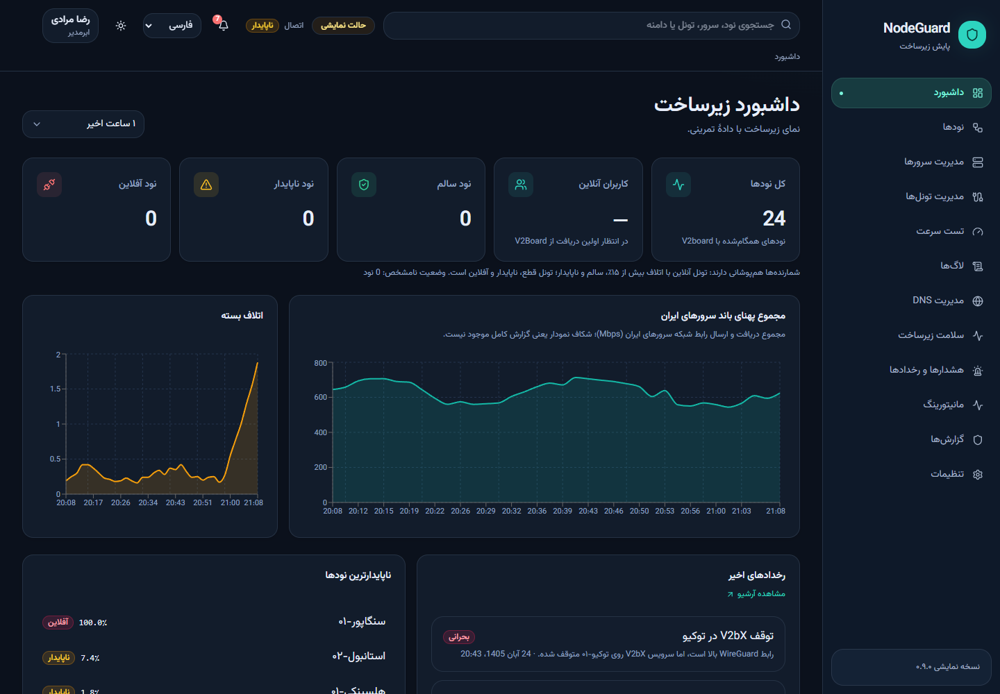
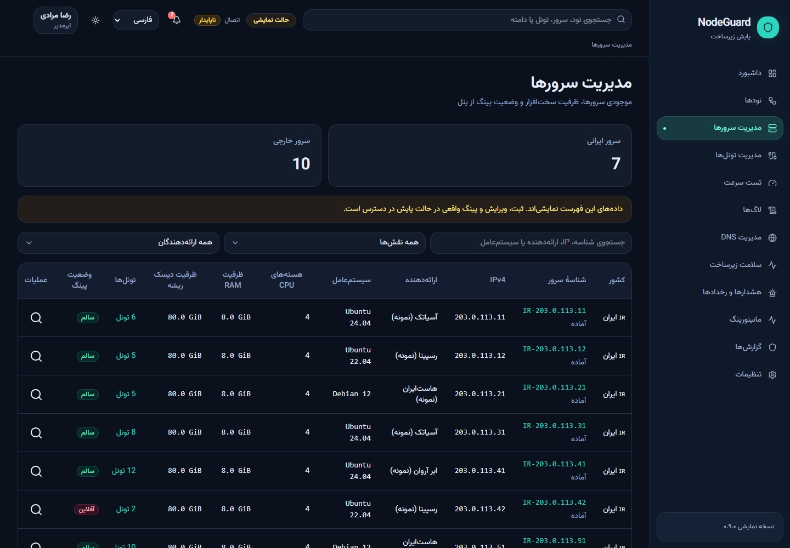
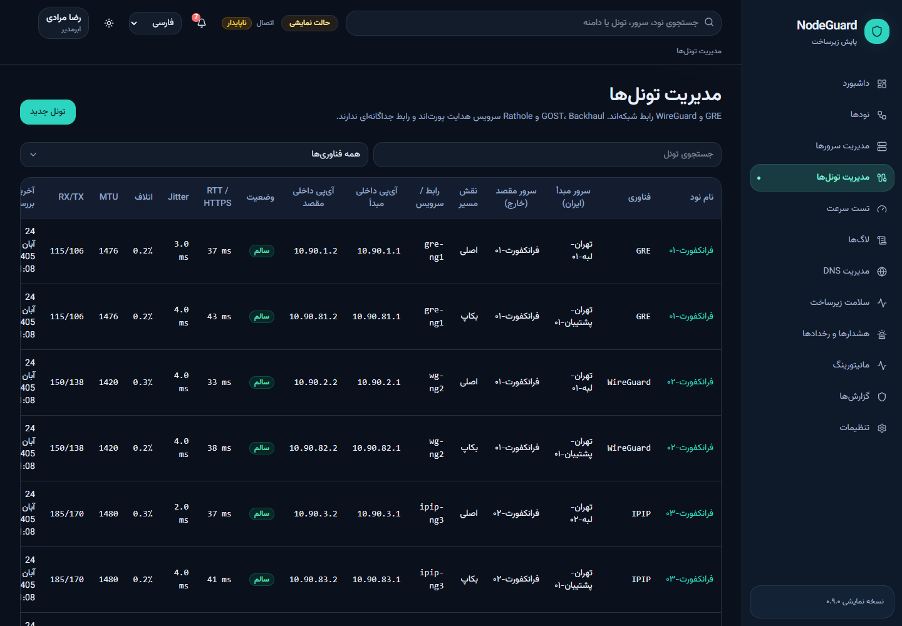

<div align="center">

# NodeGuard

**پایش سرورها، مدیریت نودها و کنترل تونل‌ها در یک پنل فارسی**

رابط راست‌به‌چپ · Agent لینوکس · تاریخچهٔ پایش · مسیرهای اصلی و پشتیبان

[شروع سریع](#quick-start) · [نحوهٔ کار](#how-it-works) · [امکانات](#features) · [پایش واقعی](#monitor) · [تصاویر پنل](#screenshots) · [مستندات](#docs)


</div>

---

NodeGuard وضعیت سرورها، نودها و تونل‌ها را در یک پنل جمع می‌کند. منابع میزبان و هشدارها را ببینید، مسیرهای اصلی و پشتیبان را بررسی کنید و با تنظیم Agent و Worker، پایش و عملیات زیرساخت را از همان پنل پیگیری کنید.

- **شروع ساده:** پنل را محلی اجرا کنید و با داده‌های نمونه، بخش‌های مختلف را بشناسید.
- **دید یکپارچه:** وضعیت سرورها، تونل‌ها، نودها و هشدارها را کنار هم ببینید.
- **پایش واقعی:** Agent لینوکس اطلاعات میزبان را به پنل می‌فرستد و تاریخچه در SQLite ذخیره می‌شود.
- **مدیریت متمرکز:** اتصال‌های V2Board، DNS و اعلان تلگرام را در کنار مسیرهای تونل تنظیم کنید.

> [!NOTE]
> تصاویر این صفحه از محیط نمایشی با داده‌های نمونه گرفته شده‌اند. دریافت اطلاعات واقعی به حالت `monitor` و راه‌اندازی Agent نیاز دارد.



<a id="how-it-works"></a>

## نحوهٔ کار

پنل وب و API در یک برنامه اجرا می‌شوند. برای دریافت اطلاعات هر میزبان، Agent آن سرور را نصب می‌کنید؛ برای اجرای عملیات، Workerهای مربوط را نیز راه می‌اندازید.

```text
Browser ──HTTPS──▶ NodeGuard (Web + API) ──▶ SQLite
                         ▲
                         │ heartbeat / telemetry
                    Linux Agents
                         │
                   Servers & Tunnels

Workers ──job queue──▶ Provision / DNS / Speed tests / Alerts
```

- **پنل و API:** نمایش وضعیت، احراز هویت، تنظیمات و ثبت درخواست‌های عملیاتی.
- **Agent:** ارسال داده‌های میزبان و دریافت وظایف مجاز همان سرور.
- **Worker:** پردازش صف عملیات فعال‌شده، از استقرار تا آزمون سرعت و اعلان.
- **SQLite:** نگهداری داده‌های بک‌اند و تاریخچه روی دیسک محلی ماندگار.

برای آشنایی از `simulation` استفاده کنید؛ برای موجودی واقعی و گزارش Agent، حالت `monitor` را تنظیم کنید. داده‌های نمونهٔ رابط در `localStorage` مرورگر نگهداری می‌شوند و از ذخیره‌سازی بک‌اند جدا هستند.

<a id="features"></a>

## امکانات

- داشبورد وضعیت سرورها، نودها، مصرف منابع و هشدارها.
- ثبت سرور و مسیر اصلی و پشتیبان تونل؛ مشاهدهٔ جزئیات و گزارش‌ها.
- دریافت داده‌های واقعی از Agent لینوکس و نمایش تاریخچهٔ پایش.
- مدیریت مسیرهای تونل و استقرار بسته‌های پشتیبانی‌شده از طریق Worker.
- اتصال به V2Board و مدیریت تنظیمات مرتبط با V2bX.
- بررسی DNS و اجرای Failover با پیش‌بررسی و تنظیمات صریح عملیاتی.
- آزمون سرعت، لاگ، گزارش، کنترل دسترسی و اعلان تلگرام.

قابلیت‌های عملیاتی به تنظیمات سرویس‌دهنده، نصب Worker و فعال‌سازی گزینه‌های مربوط نیاز دارند. شرح پیش‌نیازها در [راهنمای کامل](docs/advanced-guide.fa.md) آمده است.

<a id="quick-start"></a>

## شروع سریع

### ۱. دریافت پروژه

برای اجرای پنل روی کامپیوتر خودتان، **Node.js 24**، **npm** و **Git** نصب کنید.

```sh
git clone https://github.com/Rezasharifi9/ServerMonitoringSystem.git
cd ServerMonitoringSystem
npm ci
```

### ۲. آماده‌سازی تنظیمات

فایل تنظیمات نمونه را کپی کنید:

در Windows / PowerShell:

```powershell
Copy-Item .env.example .env.local
```

در Linux / macOS:

```sh
cp .env.example .env.local
```

### ۳. اجرای پنل

پنل را اجرا کنید:

```sh
npm run dev
```

مرورگر را روی [http://localhost:3000](http://localhost:3000) باز کنید. از انتخاب زبان در بالای پنل، «فارسی» را انتخاب کنید. تنظیمات نمونه از حالت `simulation` استفاده می‌کنند. برای دیدن رابط نمایشی نیازی به اتصال سرور واقعی ندارید؛ ورود به API خصوصی به تنظیم حساب نیاز دارد.

### ۴. ورود به بک‌اند در محیط آزمایشی

یک توکن تصادفی بسازید:

```sh
node -p "require('node:crypto').randomBytes(32).toString('hex')"
```

در `.env.local` خط زیر را با مقدار تولیدشده قرار دهید و برنامه را دوباره اجرا کنید:

```dotenv
NODEGUARD_USER_TOKENS='{"usr-reza":"YOUR_RANDOM_HEX_TOKEN"}'
```

از منوی کاربر، «ورود به بک‌اند» را انتخاب و شناسهٔ `usr-reza` و توکن خودتان را وارد کنید. این حساب در محیط آزمایشی نقش ابرمدیر دارد. برای محیط عملیاتی، حساب ادمین و ورود با رمز را مطابق راهنمای استقرار تنظیم کنید.

### ۵. بررسی اولین اجرا

1. در داشبورد، خلاصهٔ وضعیت و هشدارها را ببینید.
2. از «مدیریت سرورها»، فهرست میزبان‌ها و جزئیات هر سرور را باز کنید.
3. در بخش تونل‌ها، مسیرها و ارتباط سرور ایران و خارج را بررسی کنید.
4. در حالت پایش واقعی، سرور را ثبت و Agent آن را نصب کنید؛ سپس رسیدن اولین گزارش را بررسی کنید.
5. اتصال‌های V2Board، DNS و اعلان‌ها را در بخش تنظیمات و یکپارچه‌سازی‌ها تکمیل کنید.

<a id="monitor"></a>

## راه‌اندازی برای سرورهای واقعی

**پیش‌نیازها:** Node.js 24 برای پنل، دیسک محلی ماندگار برای SQLite و Linux با systemd 247+ و Python 3.10+ برای میزبان Agent.

1. از [فایل موجودی نمونه](inventory.example.json) یک نسخه بسازید و سرورهای خودتان را وارد کنید. این فایل هنگام ایجاد پایگاه‌داده خوانده می‌شود؛ بعداً ثبت سرور از پنل هم ممکن است.
2. در فایل محیطی، حالت `monitor`، مسیر موجودی و یک فایل SQLite جداگانه را مشخص کنید:

```dotenv
NODEGUARD_WORKSPACE_MODE=monitor
NODEGUARD_INVENTORY_PATH=inventory.example.json
NODEGUARD_DB_PATH=.nodeguard/monitor.sqlite
```

3. حساب ادمین، مبدأ عمومی HTTPS و کوکی امن را طبق راهنمای استقرار تنظیم کنید. فایل نمونهٔ موجودی آدرس‌های مستنداتی دارد و باید متناسب با محیط شما ویرایش شود.
4. در جزئیات سرور، «نصب NodeGuard Agent» را دنبال کنید. میزبان Agent به Linux، systemd 247+ و Python 3.10+ نیاز دارد.
5. ابتدا دریافت داده و سلامت Agent را بررسی کنید، سپس Workerها و قابلیت‌های عملیاتی موردنیاز را فعال کنید.

برای اجرای نسخهٔ تولید:

```sh
npm run build
npm run start
```

برای سرویس دائمی، تنظیم ورود و Workerها، [راهنمای Linux و systemd](deploy/systemd/README.md) یا [راهنمای Windows Server و IIS](deploy/windows/README.md) را دنبال کنید. SQLite باید روی دیسک محلی ماندگار قرار بگیرد. پیش از تغییرات عملیاتی، از پایگاه‌داده و تنظیمات خصوصی نسخهٔ پشتیبان بگیرید.

<a id="screenshots"></a>

## تصاویر پنل

<details>
<summary>مدیریت سرورها</summary>



</details>

<details>
<summary>مدیریت تونل‌ها</summary>



</details>

## ساختار و پیاده‌سازی

رابط با **Next.js، React و TypeScript** ساخته شده و برای نمایش فارسی و راست‌به‌چپ طراحی شده است. API در همان برنامه اجرا می‌شود، داده‌های بک‌اند در **SQLite** می‌مانند و Agent و Workerهای میزبان با **Python** اجرا می‌شوند.

- `src/app`: صفحه‌ها و مسیرهای API.
- `src/components`: اجزای رابط و نماهای پنل.
- `src/server`: احراز هویت، ذخیره‌سازی و منطق بک‌اند.
- `src/services` و `src/stores`: ارتباط رابط با API و وضعیت برنامه.
- `agent`: Agent لینوکس، نصب‌کننده و Workerها.
- `deploy`: نمونه‌ها و دستورهای استقرار.
- `tests`: بررسی‌های خودکار.
- `docs`: راهنماهای فنی و تصاویر پنل.

## توسعه و بررسی

```sh
npm run lint
npm run build
npm run test:backend
npm run test:i18n
```

تست بک‌اند به Python 3.10+ نیاز دارد و سرور محلی و SQLite موقت می‌سازد. برای تغییر کد Next.js، راهنمای نسخهٔ نصب‌شده در `node_modules/next/dist/docs/` و دستورهای [AGENTS.md](AGENTS.md) را بخوانید.

## به‌روزرسانی

پیش از به‌روزرسانی، از SQLite و تنظیمات خصوصی نسخهٔ پشتیبان بگیرید. تغییرات نسخه را بررسی و در نسخهٔ مستقرشده اجرا کنید:

```sh
git pull --ff-only
npm ci
npm run build
```

سپس سرویس پنل را مطابق [راهنمای Linux](deploy/systemd/README.md) یا [راهنمای Windows](deploy/windows/README.md) دوباره راه‌اندازی کنید. در اجرای دستی، فرایند قبلی را متوقف و `npm run start` را اجرا کنید. پس از اجرا، ورود به پنل و دریافت آخرین heartbeat را بررسی کنید.

## پرسش‌های رایج

**چرا بعد از اجرا سرورهای نمونه می‌بینم؟**

تنظیمات اولیه برای نمایش و آزمایش است. برای زیرساخت خودتان `monitor`، موجودی واقعی و Agent را تنظیم کنید.

**چرا API خطای ورود می‌دهد؟**

نمایش مرورگر با نشست بک‌اند متفاوت است. در محیط آزمایشی توکن کاربر را تنظیم و وارد شوید؛ در محیط عملیاتی از حساب ادمین استفاده کنید.

**چرا نمودارهای سرور واقعی داده ندارند؟**

نصب Agent، نشانی پنل، اتصال شبکه و زمان آخرین heartbeat را بررسی کنید.

**آیا اجرای پنل به‌تنهایی DNS یا تونل‌ها را تغییر می‌دهد؟**

اجرای عملیاتی به تنظیم دسترسی‌ها، فعال‌سازی قابلیت مربوط و Worker نیاز دارد. حالت نمایشی برای مشاهده و آزمایش رابط است.

**اطلاعات حساس را کجا نگه دارم؟**

توکن‌ها، رمزها و کلیدها را در فایل محیطی خصوصی نگه دارید. `.env.local` و پایگاه‌دادهٔ محلی نباید در مخزن منتشر شوند. `.env.example` فقط نمونهٔ تنظیمات است.

<a id="docs"></a>

## مستندات تکمیلی

- [راهنمای کامل تنظیمات، Agent، Workerها، DNS و Failover](docs/advanced-guide.fa.md)
- [استقرار Linux و systemd](deploy/systemd/README.md)
- [استقرار Windows Server و IIS](deploy/windows/README.md)
- [معماری کنترل‌پلین و شرط پذیرش عملیاتی](docs/control-plane.md)
- [مدیریت Agent و نود](docs/agent-and-node-management.md)
- [ذخیره‌سازی داده‌های پایش](docs/telemetry-storage.md)
- [ثبت مسیر پشتیبان](docs/backup-registration-policy.md)
- [فورواردِرهای بومی](docs/native-forwarders.md)
- [فایل‌ها و تنظیمات V2bX](docs/v2bx-files.md)
- [TLS در V2bX](docs/v2bx-tls.md)
- [اتصال Virtualizor](docs/virtualizor.md)

برای گزارش مشکل یا پیشنهاد، در [Issues مخزن](https://github.com/Rezasharifi9/ServerMonitoringSystem/issues) نسخهٔ Node.js، سیستم‌عامل، مراحل بازتولید و لاگ بدون اطلاعات محرمانه را بنویسید.
